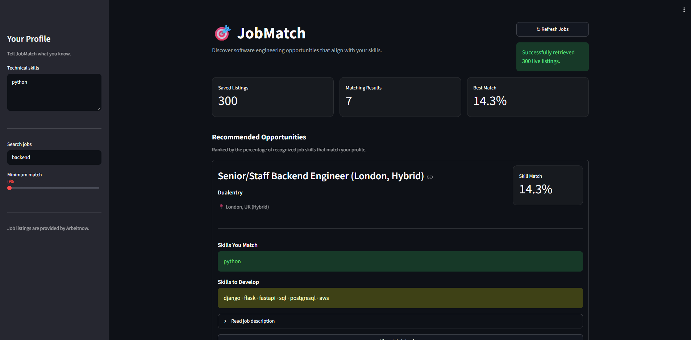
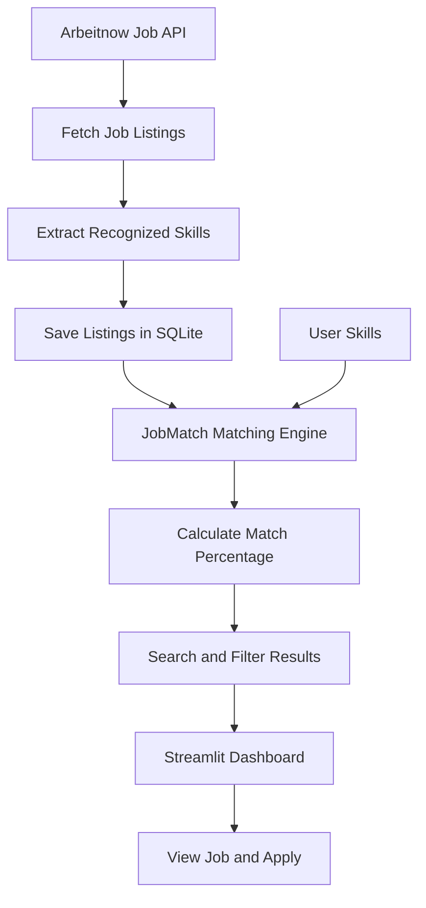

# 🎯 JobMatch

**Find software engineering opportunities that match your technical skills.**

JobMatch is a Python-based job matching application that retrieves live job listings, compares their recognized technical skills against a user's profile, and ranks opportunities by a calculated match percentage.

The project combines a live job API, a local SQLite database, and a Streamlit dashboard to make job discovery and skill comparison easier.

> **Project status:** Working MVP. Live job retrieval, SQLite persistence, skill matching, and the Streamlit dashboard have been implemented.

## ✨ Features

- **Live job listings** — Retrieve job opportunities from the Arbeitnow public job board API.
- **Skill-based matching** — Compare your technical skills against skills recognized in job tags and descriptions.
- **Match percentage** — Calculate a percentage based on recognized skills matched.
- **Job search** — Search listings by job title or recognized skill.
- **Match filtering** — Set a minimum match percentage to narrow results.
- **Ranked recommendations** — Sort matching jobs from highest to lowest match.
- **SQLite persistence** — Store retrieved listings locally and reuse saved jobs.
- **API fallback** — Load saved listings when the API is unavailable.
- **Application links** — Open the original job listing to review and apply.
- **Streamlit dashboard** — Use a visual interface instead of relying only on terminal output.

## 🖥️ Dashboard

The Streamlit dashboard provides a visual interface for:

- Entering your technical skills
- Searching job titles and skills
- Filtering by minimum match percentage
- Viewing matched and missing skills
- Reviewing job descriptions
- Opening application links
- Refreshing live job listings


Example: 

## 🧰 Tech Stack

| Technology | Purpose |
|---|---|
| Python | Application logic and skill matching |
| Arbeitnow API | Live job listing data |
| SQLite | Local job listing storage |
| Streamlit | Interactive dashboard |
| JSON | Sample job data and structured data handling |
| Git & GitHub | Version control and project hosting |

## ⚙️ How It Works



### Matching calculation

JobMatch calculates a score using the number of recognized required skills matched against the total recognized skills for a listing.

```text
Match Percentage =
(Number of Matched Skills / Number of Recognized Required Skills)
× 100
```

For example, if a job has four recognized required skills and a user's profile matches three:

```text
3 / 4 × 100 = 75%
```

The score is a simplified indicator of skill overlap. It does not evaluate every job requirement, years of experience, education, seniority, or the quality of a candidate's work.

If no recognized skills are detected in a listing, its score may not be meaningful.

## 🚀 Getting Started

### Prerequisites

- Python 3.10 or newer
- Git
- Internet access for retrieving live job listings

### 1. Clone the repository

```bash
git clone https://github.com/Emmy81/JobMatch.git
cd JobMatch
```

### 2. Create a virtual environment

```bash
python -m venv .venv
```

Activate it:

**Windows**

```bash
.venv\Scripts\activate
```

**macOS / Linux**

```bash
source .venv/bin/activate
```

### 3. Install dependencies

```bash
pip install -r requirements.txt
```

### 4. Run the dashboard

```bash
streamlit run app.py
```

Streamlit will provide a local URL, usually:

```text
http://localhost:8501
```

Open that address in your browser.

### Run the terminal version

JobMatch also includes a command-line interface:

```bash
python main.py
```

## 📁 Project Structure

```text
JobMatch/
│
├── app.py              # Streamlit dashboard
├── main.py             # API integration and matching logic
├── database.py         # SQLite database operations
├── jobs.json           # Sample job listings and fallback data
├── jobmatch.db         # Local database, created automatically
├── requirements.txt    # Python dependencies
└── README.md           # Project documentation
```

The SQLite database is generated locally when the application initializes. It is not necessary to commit the database file to GitHub.

## 🔌 API Information

JobMatch uses the public Arbeitnow job board API:

- API endpoint: [https://www.arbeitnow.com/api/job-board-api](https://www.arbeitnow.com/api/job-board-api)
- Job board: [https://www.arbeitnow.com](https://www.arbeitnow.com)

The application retrieves job listings and uses available tags and descriptions to identify recognized technical skills.

The API is a data source; JobMatch's matching and ranking logic is implemented in this project.

## 🛣️ Roadmap

### Implemented

- [x] Python matching engine
- [x] Skill normalization and aliases
- [x] Search by job title or skill
- [x] Minimum match percentage filter
- [x] Arbeitnow API integration
- [x] SQLite job storage
- [x] Saved-job fallback
- [x] Streamlit dashboard
- [x] Application links

### Potential Improvements

- [ ] Improve skill extraction and matching accuracy
- [ ] Add user profiles and saved preferences
- [ ] Add job bookmarking
- [ ] Add more job data sources
- [ ] Add automated tests
- [ ] Improve dashboard filtering and presentation
- [ ] Add deployment instructions and a hosted demo

## ⚠️ Limitations

- Job availability and listing details depend on the external API.
- The API may be temporarily unavailable.
- Skill extraction is based on recognized technical terms.
- A high match percentage does not guarantee qualification or employment.
- JobMatch does not submit applications on behalf of users.
- The application is an MVP and may require further validation and improvement.

## 👨‍💻 Author

**Chikaodili Emmanuel**

Computer Science student and aspiring software engineer.

- GitHub: [@Emmy81](https://github.com/Emmy81)

## 🙌 Acknowledgements

- [Arbeitnow](https://www.arbeitnow.com) for providing public job listing data.
- [Streamlit](https://streamlit.io) for the dashboard framework.
- The Python community for its documentation and tools.

---

*Built as a practical project to explore API integration, data persistence, skill matching, and software development workflows.*
